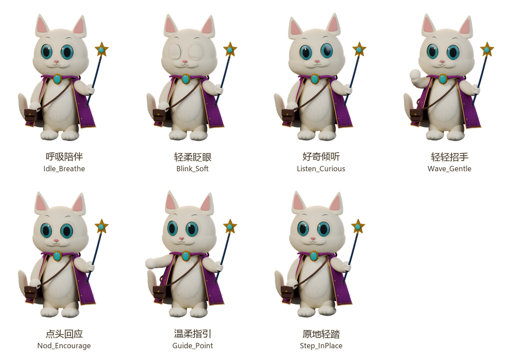

# 露米自然动作版：绑定与产品调用接口

更新日期：2026-10-24。此版本从审核过的露米自然精修 v4 工程转换，独立登记为 `lumi-animated-v4`（资产版本 `4.1.0`），不覆盖 `lumi` 原版、小鹿资产或用户导入模型。

## 产品入口与交付

- 入口：伙伴收藏 → 小猫露米（`/#/pets/lumi`）→ 模型版本 → **自然动作版** → 预览 3D 与动作。
- 预览、旋转、切换版本均不替换当前伙伴。电脑客户端需点击“设为桌面小伙伴”并再次确认，才在本机保存并调用；重启可恢复。
- 手机浏览器可预览真实三维动作。“在本页显示露米”仍是透明立绘，不是系统级三维悬浮桌宠；浏览器移动视口测试不等于 Android 真机性能验收。
- 实时资产：`apps/web/public/models/lumi-animated-v4/Lumi_Natural_v4_Animated.glb`。所有贴图与动作内嵌，无相机、灯光、地面、展示台或背景板。
- 资产清单：同目录 `character_manifest.json`。13,171,996 字节，99,496 三角形，186 个 glTF 网格，33 根导出骨骼，4 块形变眼睑。
- SHA-256：`14c6ac8e79fb51a1c4c7be44b63a4e78fdbf77599b93b7f90695f4d8fa782ead`。浏览器、本机资源白名单及动作桥使用同一摘要；损坏资源拒绝加载。



## 动作合同

所有片段按 30 fps 制作，GLB 中真实存在蒙皮或形态键轨道，不用 CSS 漂移、图片序列或缩放眼球代替动作。左右均指角色的解剖学方向：**左爪持杖，右爪招手／引导**，与画面左右相反。

| 动作 ID | 语义 | 时长 | 播放行为 |
| --- | --- | --- | --- |
| `Idle_Breathe` | `idle` | 4 秒 | 循环；胸腹局部扩张，尾尖与披风细微跟随；根骨和脚不整体上下漂浮。 |
| `Blink_Soft` | `blink` | 0.3 秒 | 独立面部层，上下眼睑闭合再睁开，不中断身体片段。 |
| `Listen_Curious` | `listening` | 3 秒 | 眼神先行，头部轻转与侧倾，耳朵稍后跟随。 |
| `Wave_Gentle` | `greeting` | 2.5 秒 | 空闲右爪抬起、停顿、小幅招手再放下，左爪保持握杖。 |
| `Nod_Encourage` | `encouraging` | 2 秒 | 小幅柔和点头，耳朵有轻微延迟。 |
| `Guide_Point` | `guiding` | 3 秒 | 视线先转向右爪方向，空闲爪舒展指引，不用魔杖穿过身体。 |
| `Step_InPlace` | `walking` | 2 秒 | 循环；双脚交替轻抬，支撑脚 IK 锁定，**不产生向前位移**。 |

身体单次动作结束后自动回到 `Idle_Breathe`，切换使用 0.18 秒过渡。呼吸／脚步播放期间约每 3.3–6.5 秒随机触发一次轻眨眼。调用新身体动作会打断旧动作，不自动排队。

## Web / Three.js 接口

在 `apps/web/src` 内调用，`container` 为宿主提供的非零尺寸 HTMLElement：

```ts
import { loadLumiAnimatedModel } from './three-d/builtin-models';
import { createModelView } from './three-d/viewer';

const controller = new AbortController();
const source = await loadLumiAnimatedModel(controller.signal);
const view = await createModelView(container, source, { interactive: true });
const actions = view.lumiActions;

if (actions) {
  const supported = actions.list();
  const result = actions.semantic('greeting');
  if (!result.ok) throw new Error(result.message);
  actions.play('Listen_Curious');
  actions.play('Blink_Soft');
  actions.stop();
  actions.semantic('idle');
}

view.dispose();
controller.abort();
```

- `view.lumiActions` 仅在识别到本版露米时提供；`list()` 只列出实际加载片段，返回副本。
- `play(name)` / `semantic(name)` 返回 `{ ok: true, action, durationMs, loop }`，或 `{ ok: false, code, message }`。错误码为 `invalid`（未知动作／语义）、`unsupported`（实际资产无对应片段）、`unavailable`（接口已销毁）。
- `state.action` 是当前**身体**动作；眨眼为叠加面部层，不将身体状态改成 `Blink_Soft`。
- `stop()` 停止动作与自动眨眼，恢复绑定姿态，不销毁渲染器。恢复陪伴可调用 `semantic('idle')`。退出页面或切换资产必须 `view.dispose()`。
- 通用 `view.animationNames`、`view.playAnimation(name)`、`view.stopAnimation()`、`view.currentAnimation` 仍可使用；原版露米与栗栗复用这一通用接口。栗栗已有 5 个绑定动作，参见[栗栗自然精修接口](./lili-natural-v4-model-interface.md)，不要把两角色的动作名混用。

## Electron 跨窗口接口

只在产品可信本机管理页、工具页和桌宠窗口提供 `window.nuanbanLumi`。它控制**已应用且当前可见的自然动作版露米**，不会偷偷替用户切换模型，也不是对外 HTTP 服务。

```ts
const api = window.nuanbanLumi;
if (!api) throw new Error('请使用支持该接口的电脑客户端');

const descriptor = await api.describe();
const unsubscribe = api.onAction(event => {
  console.log(event.action, event.at);
});
const result = await api.semantic('greeting');
if (!result.ok) throw new Error(result.message);
await api.play('Guide_Point');
await api.stop();
await api.play('Idle_Breathe');
unsubscribe();
```

`describe()` 返回资产 ID、版本与七个动作定义，**不代表桌宠已就绪**。首次设置需用户确认后通过既有 `window.nuanbanModel.applyBuiltin('lumi-animated-v4')` 保存；可以用 `'lumi'` 切回原版。不要在后台调用应用模型接口来绕过确认。

`play()` / `semantic()` 的成功结构与 Web 相同；`stop()` 成功返回 `{ ok: true, action: 'stop' }`。主进程先验证来源和模型摘要，再发送唯一请求 ID，**收到当前桌宠渲染器实际接受动作的确认后才返回成功**。成功含义是“已开始／已停止”，不是“片段已播放完毕”；`onAction` 同样是接受通知，而非结束回调。

未知动作、额外参数返回 `invalid`。未应用本模型、模型加载中、桌宠关闭或收起为悬浮球、云形象覆盖本模型、渲染器拒绝、确认超过 3 秒或待确认请求达到 16 个时，返回 `unavailable`。模型切换和释放桥会取消等待确认的调用。只有可信桌宠主框架可确认请求；管理页和其他网页不可伪造确认。

`onRequest` / `complete` 是桌宠 preload 与主进程内部协议，不应被业务侧直接调用。页面卸载应注销监听器；产品已在 `pagehide` 清理。

## 资产边界与可编辑源

- 保留自然精修 v4 的奶油绒毛、蓝绿眼、紫金披风、胸针、斜挎包和握杖造型。实时版采用减面网格、内嵌贴图和 13,180 张五股毛卡，从 215,319 条离线毛曲线采样，**不是无损电影级曲线毛发**。
- 绑定工程保存在本机 `work/lumi-animated-v4/lumi-natural-v4-rigged.blend`，实时 GLB 已纳入仓库。大体积 `.blend`、调试日志与本地运行数据不提交。
- 披风、尾巴和包使用预制辅助骨跟随，没有实时布料物理、碰撞解算、口型同步、完整面部捕捉或 Android 系统悬浮动画接入。
- 实际使用了本地 Blender MCP 插件的环回桥接执行 `bpy`、绑定、导出与 Cycles 审查渲染；没有声称调用未连接的 ComfyUI、Tripo 或 Unity 服务。

## 重建与验证

需要可访问审核源 `work/lumi-natural-v4/lumi-natural-v4.blend`（摘要见清单）、兼容毛曲线的 Blender、NumPy 和现有 Blender MCP 插件；只有仓库克隆不能重建缺失的离线源工程。使用独立隐藏 Blender 进程和未被占用的环回端口，启动方法参见[静态精修说明](../../design/characters/lumi-natural-v4/README.md)。不要操作其他用户会话。

从静态 v4 源打开后运行完整转换，端口按自己的新进程调整：

```powershell
python scripts/characters/blender-mcp-local.py call --port 9893 --timeout 1800 `
  --script scripts/export-lumi-natural-rigged.py `
  --arguments '["apps/web/public/models/lumi-animated-v4"]'
```

完整脚本会减面、转换毛发与材质、保存未绑定缓存，再执行绑定。仅迭代动作时，先单独打开 `work/lumi-actions-task/lumi-runtime-unbound.blend`，下一次调用 `scripts/characters/bind-lumi-actions.py`，传相同输出目录；不能在已绑定场景重复绑定。重新导出后必须核对 manifest、同步 Web 元数据和原生白名单的字节数／摘要，再验证，不应放宽资源校验。

```powershell
pnpm typecheck
pnpm exec vitest run tests/platform/lumi-actions.test.ts tests/platform/lumi-animated-model.test.ts tests/platform/lumi-model.test.ts tests/platform/lumi-studio.test.ts tests/platform/desktop-local-model.test.ts tests/platform/lili-natural-model.test.ts
pnpm exec playwright test tests/e2e/lumi-animated-companion.spec.ts tests/e2e/lumi-companion.spec.ts
pnpm --filter @nuanban/web build
pnpm desktop:avatar:build
node scripts/check-lumi-actions-electron.cjs
```

浏览器验收需已安装 Playwright Chromium，或设置 `PLAYWRIGHT_CHANNEL=msedge` 使用本机 Edge。几何单测只去除贴图引用以便无 DOM 解码；真实贴图、首帧、动作按钮和 Electron 确认链由浏览器／原生联调验证。Electron 验收使用独立临时 profile，禁止采集真实桌面，结果写入忽略目录 `.cache/lumi-actions-electron-*/evidence.json`。
